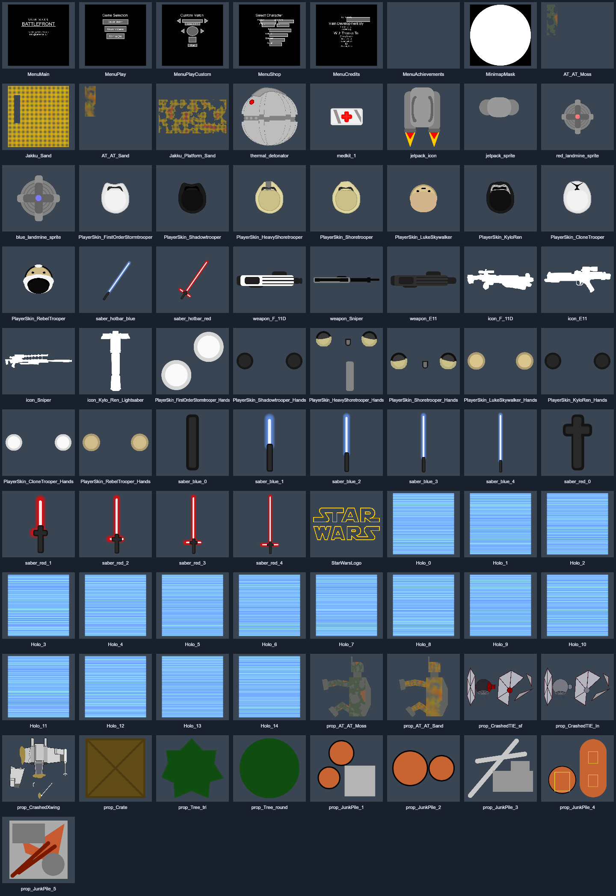

# Battlefront assets

81 PNG images from Battlefront by Coder Guy and LemoncelloJr: characters, hands, weapons, saber frames, items, scenery, textures, menu masks and hologram frames.



The images are rendered from the original artwork at higher resolution, rather than enlarging old screenshots. Most character images are 1272 × 1272; large scenery is rendered at up to 3200 × 3200 before transparent margins are cropped. Small icons are exported at four times their original dimensions.

## Editing

Edit the PNG with the matching name and keep its transparent background. Preserve its dimensions to keep the existing alignment. `manifest.json` records logical dimensions and the drawing origin separately from PNG resolution.

After editing images:

```sh
npm ci
npm run pack
npm test
```

Commit the PNG, updated manifest and `runtime.js`. The pack contains smaller runtime PNGs as base64, not drawing commands. The full-resolution PNGs stay available for editing. Runtime images are decoded once during loading and reused with `image()` throughout the game; they are not decoded every frame. `png-decoder.js` contains the PNG decoder and its compression library. The game loads these through jsDelivr because Khan's PJS image policy does not allow direct jsDelivr image URLs.

For reproducible exports from the original vector artwork, `drawings.js` is an offline source file. `npm run render` regenerates the PNGs and overwrites manual PNG edits. It is not loaded by the game. Run `node crop.cjs` after rendering to trim optional sprite margins, then pack again.

## Using the images

`pjs-loader.js` loads selected images into `assetImages`. Call `startAssets(["PlayerSkin_FirstOrderStormtrooper"])` once, then `stepAssets()` from `draw` until `assetLoad.ready` is true. `drawAsset(name, x, y, scale)` uses the stored drawing origin. `assetImages[name]` is a Processing image, so it works with `image()` and its own `.get()` method.

`battlefront-images.js` is the image-based game build. Its asset loading stage reports network or decoding failures instead of silently starting with missing sprites. The PNG pack URL is set by `assetBase`. Restart the project after updating assets; jsDelivr may cache `@main` for a while. Use a commit SHA in place of `main` when you want a fixed release.

Gameplay geometry, collision shapes, live text, bars and effects that change shape remain in the game. Those are not static image files. Existing audio URLs are unchanged.

Open `index.html` locally for an image gallery. Assets retain the original Battlefront names where possible. Art credit: Coder Guy and LemoncelloJr; the original source is in [Battlefront](https://github.com/CoderGuyxLemoncelloJr/Battlefront).
